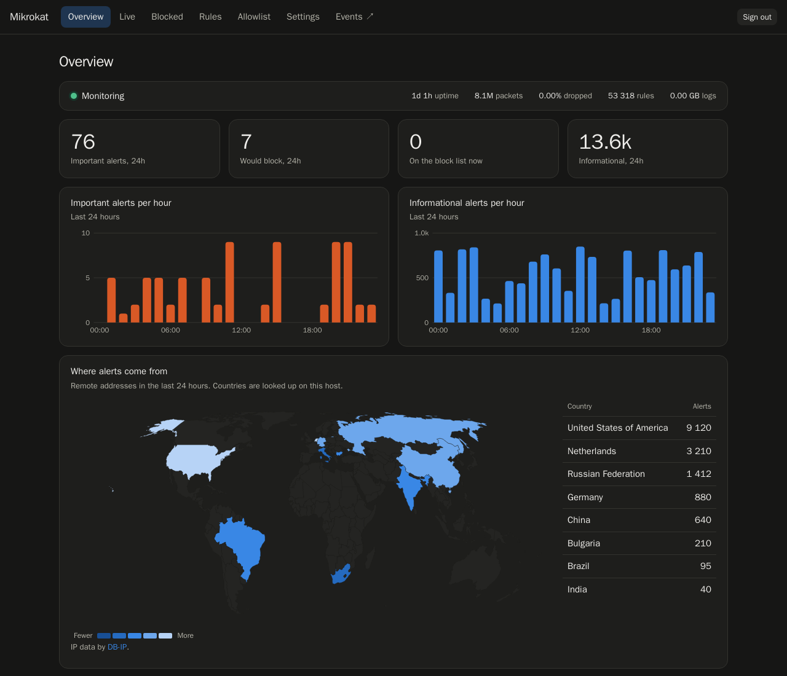

# Mikrokat

Lightweight intrusion detection for MikroTik routers.

Mikrokat runs Suricata next to your router, shows what it finds on a clean dashboard, notifies you, and can block attackers on the router through its API. It installs with one `docker compose` and needs about 600 MB of RAM with the full ET Open ruleset.

It is the lightweight successor of [mikrocata2selks](https://github.com/angolo40/mikrocata2selks), without the heavy NDR stack.



## Features

- **Detection:** Suricata 8 with the ET Open ruleset, updated from the web page without stopping it.
- **Dashboard:** alerts per hour, top rules and addresses, and a world map of where alerts come from.
- **Device names:** shows the names from your router's DHCP leases instead of bare addresses, with a page for each host.
- **Health alarms:** warns you if traffic stops arriving, the rules get old, the disk fills up or the router stops answering.
- **Automatic rule updates:** daily or weekly, without stopping Suricata.
- **Live page:** alerts and actions as they happen, with repeats grouped.
- **HTTPS inspection:** optional and off by default. Suricata can read the HTTPS of the devices you choose.
- **Blocking:** automatic or by hand, through a MikroTik address list. Blocks are put back after a router restart, and repeat offenders can be blocked for longer.
- **Safe by default:** starts in Monitor mode, which only reports. Private networks and major DNS servers are protected from blocks.
- **Notifications:** Telegram, email and webhooks for Slack, Discord, Microsoft Teams or your own service, plus an optional daily summary.
- **Explain:** optional button that describes a rule in plain words, using your own AI model. It only sends the rule text and cannot block anything.
- **SIEM export:** optional alert file, syslog or Splunk HEC, in Suricata's EVE format.
- **Events:** [EveBox](https://evebox.org) is included for browsing alerts, behind the same sign-in.
- **Single sign-on:** optional OpenID Connect, for Authentik, Keycloak, Authelia and others.

## How it works

```
MikroTik  -- TZSP/UDP 37008 -->  tzsp (TAP device tzsp0)  -->  Suricata  -->  eve log
    ^                                                                            |
    |                                                                            v
    +------ address list (when blocking is on) <---------------------------  Mikrokat
                                                                              |     |
                                                    notifications and SIEM <--+     +--> web pages
```

The router copies traffic to Mikrokat with TZSP. Mikrokat only sees what the router sends, so it does not need to sit in the traffic path. If it stops, your network keeps working.

| Container | Role |
|---|---|
| `mikrokat-tzsp` | Receives TZSP and feeds a virtual interface |
| `mikrokat-suricata` | Inspects the traffic |
| `mikrokat-app` | Web pages, alert handling, blocking, notifications |
| `mikrokat-evebox` | Event browser |
| `mikrokat-rules` | Applies rule updates on request |
| `mikrokat-tlsproxy` | Optional HTTPS inspection. Listens on nothing while it is off |

## Requirements

| | Minimum | Recommended |
|---|---|---|
| CPU | 2 cores, x86-64-v2 | 4 cores |
| RAM | 2 GB | 4 GB |
| Disk | 16 GB | 32 GB SSD |

You also need:

- Linux with Docker Engine and the Compose plugin ([install guide](https://docs.docker.com/engine/install/)), plus `git`.
- `/dev/net/tun` available to Docker.
- A MikroTik router with RouterOS 7. Blocking needs the API service, on port 8729 or 8728.

**Proxmox LXC:** works unprivileged. Turn on `nesting` and `keyctl`, and pass `/dev/net/tun`. On a VM, set the CPU type to `host`.

**Measured use:** about 600 MB of RAM and 1.1 GB of images, with 53,000 rules on a 4-core Intel N305. At about 3,000 packets per second (20 Mbps), Suricata and the TZSP receiver used about 5% of one core each. Applying rules briefly needs 500 MB more. Heavier links need more CPU, so watch **Packets dropped** on the Overview page.

**HTTPS inspection:** while off, `mikrokat-tlsproxy` uses about 3 MB of RAM and opens no port. While on, on the same CPU and with both ends on that host, a 1 GiB download through it reached 2.4 to 3.2 Gbps, with the proxy using one core and 13 MB of RAM. With 100 downloads at once and its queue full it peaked at about 105 MB. The copy for Suricata is paced to about 10 MB/s: of a 1 MiB burst, 1,546 frames were sent and 1,546 arrived.

Disk use is capped: Suricata logs at 4 GB, the EveBox database at 4 GB, and container logs at 30 MB each.

Do not run Mikrokat on the router. A container on a MikroTik device has little memory, slows routing, and puts a parser of hostile traffic on your gateway.

## Install

```sh
git clone https://github.com/angolo40/mikrokat.git
cd mikrokat
cp .env.example .env
sed -i "s/^WEB_PASSWORD=.*/WEB_PASSWORD=$(tr -dc 'a-zA-Z0-9' </dev/urandom | head -c 20)/" .env
chmod 600 .env
docker compose run -T --rm --no-deps suricata suricata-update --no-reload </dev/null
docker compose up -d
grep WEB_PASSWORD .env
```

The first run takes a few minutes: it builds three images and downloads the others and the rules. The last line shows your password.

Open `http://<host>:8088` and sign in as `admin`. The Settings page has a setup guide next to the form, and you can change the password there.

To check the path without touching the router (needs `python3`):

```sh
python3 tools/send-test-alert.py
```

A `Would block` entry appears on the Overview page. `ROUTER_HOST` can stay set: Mikrokat also accepts TZSP from its own host (`127.0.0.1`).

## Router setup

### 1. Send traffic to Mikrokat

Replace `WAN` with your interface list and `192.0.2.10` with the Mikrokat host.

```
/ip firewall mangle add chain=forward out-interface-list=WAN action=sniff-tzsp sniff-target=192.0.2.10 sniff-target-port=37008 comment=mikrokat
/ip firewall mangle add chain=forward in-interface-list=WAN action=sniff-tzsp sniff-target=192.0.2.10 sniff-target-port=37008 comment=mikrokat
```

These rules send only the traffic to and from the internet. In the forward chain the router still sees internal addresses, so you can tell which host was involved. Fasttracked connections skip the mangle table, so they are not inspected.

Set `ROUTER_HOST` in `.env` to accept TZSP only from your router, then run `docker compose up -d`.

### 2. Allow blocking (optional)

Give Mikrokat only the rights it needs, and only from its own address:

```
/user group add name=mikrokat policy=api,read,write
/user add name=mikrokat group=mikrokat address=192.0.2.10 password=CHOOSE_ONE
/ip firewall raw add chain=prerouting action=drop src-address-list=mikrokat comment=mikrokat
/ip firewall raw add chain=prerouting action=drop dst-address-list=mikrokat comment=mikrokat
```

For IPv6, repeat the raw rules under `/ipv6 firewall raw` and turn on **Block IPv6 addresses**.

Enter the connection in Settings, then use **Test connection**. RouterOS rights are not limited to one list: this user can change the router's configuration, though not its users. Keep the address restriction.

### 3. Start in Monitor

Leave Mikrokat in Monitor for a few days. Mute noisy rules on the Overview page, and add your public addresses and trusted hosts to the Allowlist. Then switch to Block in Settings.

Your own servers can trigger rules. Without an allowlist entry, Block would cut them off.

To remove everything from the router:

```
/ip firewall mangle remove [find comment~"mikrokat"]
/ip firewall raw remove [find comment~"mikrokat"]
/ipv6 firewall raw remove [find comment~"mikrokat"]
/user remove mikrokat
/user group remove mikrokat
```

## Pages

| Page | What it does |
|---|---|
| **Overview** | Status, charts, map, devices, top rules and addresses |
| **Host** | One device or address: its rules, contacts and actions. Open it from any address |
| **Live** | Alerts and actions as they arrive |
| **Blocked** | The block list: block and unblock by hand, in any mode |
| **Rules** | Turn rules off, add your own, apply updates |
| **Allowlist** | Addresses that are never blocked or reported |
| **Settings** | Protection, notifications, router, data, HTTPS inspection and account |
| **Events** | EveBox, on port 5636 |

## Rules

Mikrokat starts from ET Open and updates it every day at 04:00. You can change that on the Data tab of Settings. On the Rules page you can turn rules off, add your own and press **Apply rules** to update right away, without stopping Suricata. The same files live in `rules/` if you prefer an editor, and `tools/update-rules.sh` applies them.

To keep a rule in Events but stop its notifications and blocks, use **Mute**.

## HTTPS inspection

Suricata cannot read HTTPS, so it sees little more than a name and a size. For the devices you choose, Mikrokat can read that traffic. `mikrokat-tlsproxy` connects to the real site, checks its certificate, and gives the browser a certificate of its own, signed by a private CA that you trust on that device. It keeps a copy of the traffic and feeds it to Suricata as plain HTTP. Your rules then fire on URLs and content, and each alert shows the real device and server, with a `decrypted` badge on the Live page.

It is off by default. The proxy only reads: it never changes traffic, and blocking stays on the router. A site with a bad certificate is passed through untouched, so the browser shows its usual warning. If the proxy stops, or it cannot open its port, browsers using the PAC file below go direct, and a health alarm appears within about two minutes. Another alarm warns when the CA has less than 30 days left.

**Inspect only your own devices, or with the consent of the person using them.** Whoever runs Mikrokat can see the URLs they open.

### What stays encrypted

Suricata sees nothing inside these. The Numbers card on the HTTPS inspection tab counts them by reason.

- Devices that are not on your list, and programs on a listed device that do not use the proxy.
- Names on the bypass list: the banks, payment, health and update services in [`tlsproxy/bypass.txt`](tlsproxy/bypass.txt), and the names you add on the tab. The list is a starting point, not a complete one.
- Apps that refuse the Mikrokat certificate, such as those with a pinned certificate. After two refusals within 10 minutes, that device and that exact name are relayed untouched for 24 hours. A device that finished a handshake with the Mikrokat certificate for a name in the last 24 hours does not earn this for that name.
- Sites that ask for a client certificate, and sites with a bad certificate.
- Everything, once the CA has expired. Connections keep working and are counted as `ca_expired`. Press **Regenerate the CA** before that.
- Connections without a server name, and Encrypted Client Hello, whose outer name `cloudflare-ech.com` is on the bypass list.
- Ports other than 443, and IPv6 addresses.
- QUIC. The proxy takes TCP only, so browsers fall back to TCP.
- Everything after the first 1 MiB in each direction of a connection. It is relayed, but no copy is kept. A rule on an HTTP response body sees less: Suricata reads the first 100 KiB by default.

### Set up one Firefox profile

1. On the HTTPS inspection tab of Settings, add the address of the device, turn on the switch and save.
2. On the same tab, use **Download the CA certificate**.
3. In Firefox, open `about:profiles`, create a new profile and launch it. Only this profile will trust the CA, not the rest of the computer.
4. In that profile, open Settings, Privacy & Security, Certificates, View Certificates, Authorities, then Import. Choose the file and tick **Trust this CA to identify websites**.
5. Under Settings, General, Network Settings, choose **Automatic proxy configuration URL** and enter `http://<host>:8088/tls.pac`.

To check it, open a site in that profile and look at its certificate: the issuer is `Mikrokat local CA`.

### The PAC file

`/tls.pac` tells a browser where to send its traffic, and it needs no login. While the feature is on, it answers `SOCKS5 <host>:1080; DIRECT` for `https:` and `wss:` addresses, which means use the proxy, or go direct if the proxy does not answer. Everything else goes direct: other schemes, plain host names and private addresses. The proxy inspects none of that, and relaying it would only hide the real device. While the feature is off, the file answers `DIRECT`.

Other programs on a listed device can use the same SOCKS5 proxy on port 1080, if they trust the CA. Through it, a listed device reaches public sites only, with the address of the Mikrokat host. The proxy refuses private addresses (10/8, 172.16/12, 192.168/16, fc00::/7), the CGNAT range 100.64/10, loopback and link-local addresses, the addresses of the host and the subnets of its Docker networks, and it does so also for a name that resolves to one of them. There is no allow-list, so an HTTPS site on your LAN with a full name, such as `nas.home.example`, fails in a browser using the PAC file. Open it from another profile.

### Limits

- **Apps must be configured.** Nothing on the router changes, so a program is inspected only if it is set to use the proxy and trusts the CA.
- **A program can ignore SOCKS.** A proxy setting is a request, not a control. Do not count on this to catch software that wants to hide.
- **URLs stay in the logs.** Suricata stores the host, URL and user agent of inspected requests for as long as EVE and EveBox keep them: 7 days by default, as set by **Keep logs for** on the Data tab, up to 4 GB. URLs can hold tokens. Passwords, cookies and bodies are not written to disk, and `tests/e2e/run.sh` checks that.
- **The CA key can impersonate any site** to every device that trusts it. It stays in `data/tls/private`, which only the proxy can read, but a backup of the host contains it. If it may have leaked, use **Regenerate the CA** and import the new certificate.
- **Copies are paced.** The copy for Suricata goes out at about 10 MB/s, and its queue holds 64 MiB. Above that rate the queue fills, and Suricata misses the rest of those connections while they keep working. With 200 downloads of 1 MiB, 100 at a time, that happened to 25 to 43 of them. **Copies dropped** on the Numbers card shows it.
- **HTTP/1.1 only.** The proxy offers no HTTP/2, so sites answer over HTTP/1.1. A program that speaks only HTTP/2 is refused, and the automatic bypass does not apply to it, because the program never rejected the certificate. Add its names to the bypass list. The same goes for a program that only speaks a TLS version older than 1.2.
- **A client certificate requested late fails.** A TLS 1.2 site that asks for one after the connection is up is refused by the proxy, and the page fails. Add its name to the bypass list.

## Sending alerts to a SIEM

Mikrokat does not need a SIEM. If you have one, the Data tab of Settings offers three ways to send alerts, all using the same record: Suricata's EVE JSON, plus Mikrokat's action, target and country under `mikrokat`.

- **Alert file:** `data/logs/alerts.json`, for an agent or forwarder to read.
- **Syslog:** RFC 5424 over UDP or TCP, with the JSON as the message body.
- **Webhook:** generic JSON, or the Splunk HEC format on the Notifications tab.

Setup notes for Splunk, Elastic, Wazuh and Graylog are in [integrations](integrations/README.md).

## Single sign-on

On the Account tab of Settings you can add any OpenID Connect provider. Create a confidential client with the redirect URI shown there, and set the group allowed to sign in. Mikrokat has one role, so everyone in that group gets full control. The password keeps working as a fallback. If you publish Mikrokat behind a reverse proxy, set `PUBLIC_URL`.

## Explain

On the AI tab of Settings, enter the address of any OpenAI-compatible API, such as `http://host:11434/v1` for Ollama, and a model name. An Explain button then appears next to rules. Mikrokat sends only the rule text, its severity and how many alerts it caused, never addresses or traffic, and it keeps each answer so it asks only once.

## Security notes

- The pages use plain HTTP. Publish them through a reverse proxy with TLS if you open them from outside your LAN. The sign-in cookie is shared by host name, so use the same host for ports 8088 and 5636.
- Router, mail and Telegram secrets are stored in `data/app/settings.json`, readable only by root.
- The app has no access to Docker. Rule updates run in a separate container.
- Countries are looked up in a local database. No address is sent to an outside service.

## Update

```sh
git pull
docker compose up -d --build
```

## Remove

```sh
docker compose down -v
```

Then delete the `data` folder, and remove the rules from the router as shown above.

## Configuration

Most settings are on the Settings page. `.env` holds the first values, and `.env.example` lists them all. Once you save the page, its values replace those in `.env`.

## Troubleshooting

- **The page does not open:** `WEB_PASSWORD` is empty, so the web pages stay off. Set it in `.env` and run `docker compose up -d`. `docker logs mikrokat-app` shows the same message.
- **Packets stay at 0:** the router is not sending traffic to Mikrokat. Check the mangle rules and the target address, and that `ROUTER_HOST` is the address the router sends from.
- **A container does not start:** check `docker compose ps -a` and `docker logs` for that container. Without `/dev/net/tun`, `mikrokat-tzsp` cannot start.

## License

GPL-3.0. See [LICENSE](LICENSE). Inspired by [zzbe/mikrocata](https://github.com/zzbe/mikrocata).

Built with [Suricata](https://suricata.io) and [EveBox](https://evebox.org). IP country data by [DB-IP](https://db-ip.com), CC BY 4.0, downloaded monthly and read locally. Map data from [Natural Earth](https://www.naturalearthdata.com), public domain.
